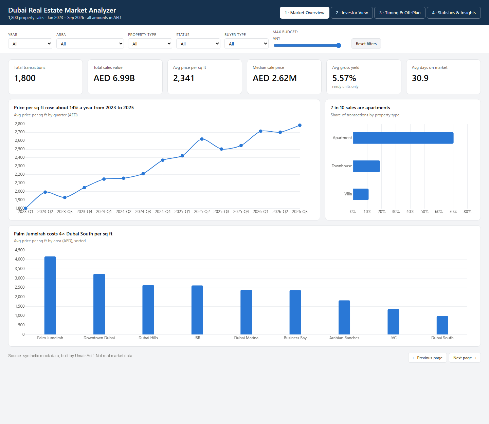
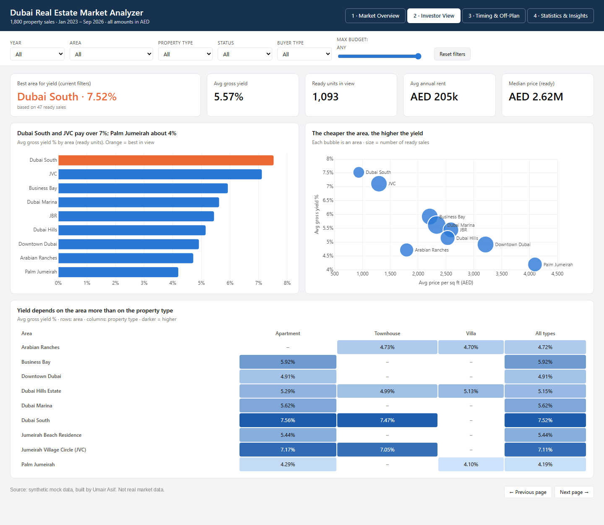
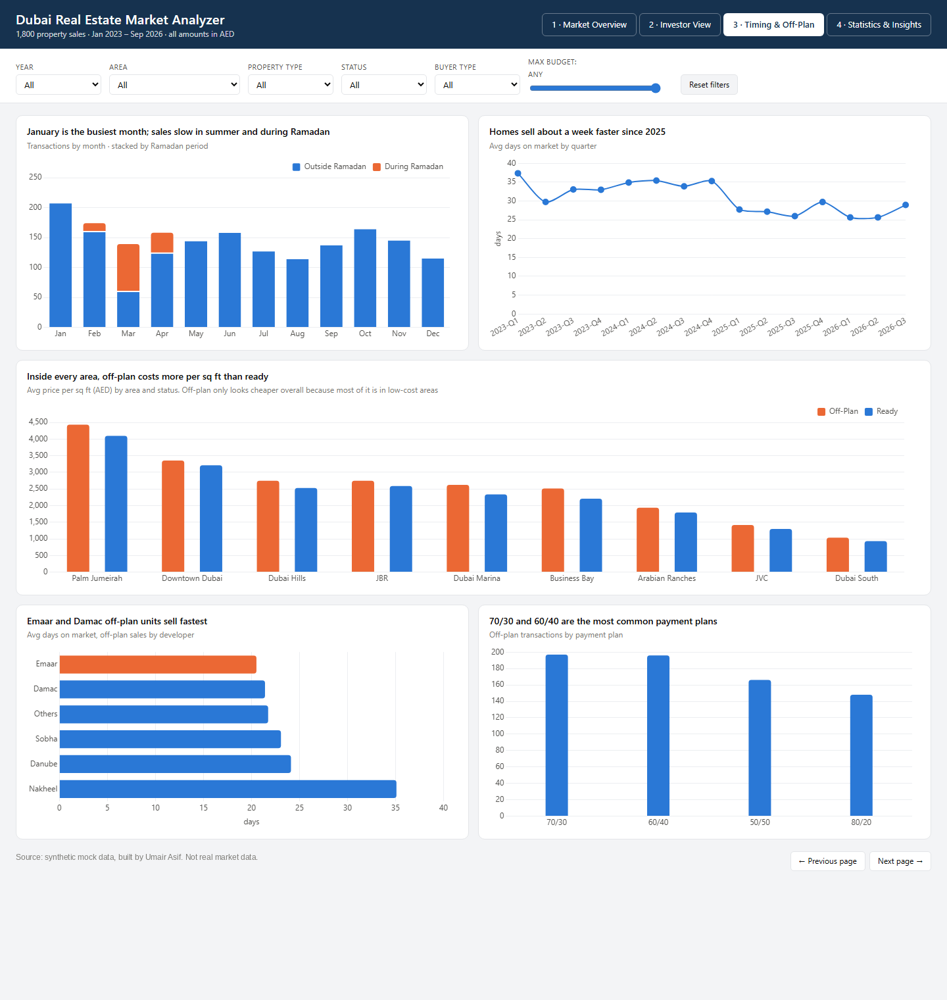
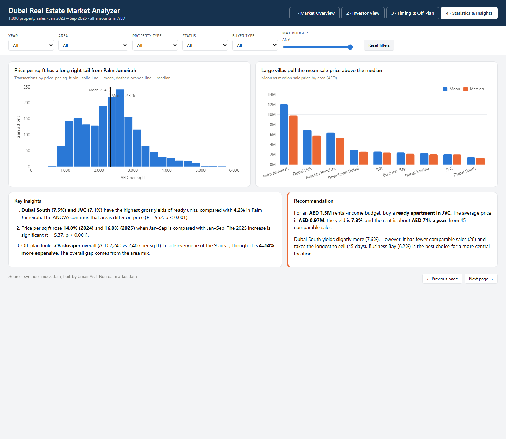

# Dubai Real Estate Market Analyzer

An analysis of 1,800 mock Dubai property sales. It finds the best areas for rental yield, tracks price trends and seasonality, and checks whether off-plan really is cheaper than ready.

> **Note: the dataset is synthetic and was created for learning. The numbers do not describe the real Dubai market.**

## Business Problem
A developer or investment firm needs to know where to invest, when to buy, and what the risks are.
- Which areas offer the best gross rental yield?
- How have prices per sq ft changed since 2023?
- Is there a seasonal pattern, such as Ramadan or summer?
- Is off-plan cheaper than ready *within the same area*?
- Where should an investor with an AED 1.5M budget buy for rental income?

## Dataset
`data/dubai_real_estate_mock.csv` holds 1,800 rows and 21 columns, from Jan 2023 to Sep 2026 (2026 is a partial year). All amounts are in AED.

| Column | Meaning |
|---|---|
| date, year, quarter, month, ramadan_period | When the sale happened |
| area, property_type, bedrooms, size_sqft, view | What was sold and where (9 areas) |
| status, developer, payment_plan | Ready (1,093) or Off-Plan (707), developer, and payment split |
| sale_price_aed, price_per_sqft_aed, days_on_market | Price and how fast it sold |
| annual_rent_aed, gross_yield_pct | Rent and yield (ready units only) |

## Tools
Power BI (DAX, Power Query), Python (pandas, SciPy, statsmodels, matplotlib), Chart.js, Excel. Statistics used: sampling distributions and the CLT, confidence intervals, t-tests, ANOVA, OLS regression, Type I/II errors and power.

## Method
- **Cleaning:** blank `view` set to "Unknown"; off-plan yield left blank (no tenant yet); "N/A" payment plan relabelled; 32 Palm Jumeirah outliers kept as real luxury sales; no rows removed.
- **EDA:** price trend, area ranking, seasonality, and days on market.
- **Sampling and CI:** 1,000 samples each of n = 30 and n = 100; 95% CIs for 4 areas.
- **Hypothesis tests:** Welch t-tests, a one-sample t-test, and one-way ANOVA.
- **Regression:** price on size, then on size + area + bedrooms + status (plus a log model).

## Key Findings
1. **Dubai South (7.52%) and JVC (7.11%)** have the highest gross yields; Palm Jumeirah has the lowest (4.19%).
2. Prices per sq ft grew **13.9% a year** from 2023 to 2025. Comparing Jan–Sep with Jan–Sep, 2025 was **+16.0%** (t = 5.37, p < 0.001).
3. Off-plan looks 6.9% cheaper overall, but it is **4.5–13.7% more expensive inside every area**. This is a Simpson's-paradox effect of the area mix.
4. Marina and Business Bay prices are statistically the same (p = 0.59), while ANOVA shows strong differences across all 9 areas (F = 952).
5. Size alone explains 75% of price. Adding area, bedrooms and status explains 91%, and location is the largest effect.

## Dashboard Preview
**[▶ Open the live interactive dashboard](https://umairasifofficalll-code.github.io/Dubai-Real-Estate-Market-Analyzer/dashboard/dubai_real_estate_dashboard.html)**. It has 4 pages, working slicers, and a budget range filter. You can also open `dashboard/dubai_real_estate_dashboard.html` locally in any browser.

📄 Full write-up: [Dubai_Real_Estate_Report.pdf](report/Dubai_Real_Estate_Report.pdf)






## Recommendations
1. For AED 1.5M and rental income, buy a **ready apartment in JVC**: about AED 0.97M, 7.29% yield, AED 70.8k a year in rent.
2. Treat Palm Jumeirah and Downtown as capital-growth plays, not income plays.
3. Do not buy off-plan expecting a discount. Buy it for the payment plan.

## How to Run
```bash
pip install pandas numpy scipy statsmodels matplotlib
python scripts/analysis.py          # cleaned CSV, results.json, figures, HTML dashboard
npm install docx && node scripts/build_report.js   # rebuilds the Word report
```
- **Power BI:** follow `dashboard/powerbi_kit/BUILD_GUIDE.md`. It uses `power_query.m`, `measures.dax` and `dubai_theme.json`, and it ends with a table of expected numbers to check against.
- **Notebook:** `notebooks/01_cleaning_and_eda.ipynb`

## Project Structure
```
data/            raw + cleaned CSV
notebooks/       exploratory notebook
scripts/         analysis.py (stats + dashboard build), build_report.js
dashboard/       HTML dashboard, PDF, screenshots/, powerbi_kit/
report/          Dubai_Real_Estate_Report.docx / .pdf, figures/, results.json
```

## Limitations
The data is mock. 2026 is partial, so comparisons use Jan–Sep only. Yields are gross, with no service charges or vacancy. There are no macro factors such as mortgage rates or supply.

## Author
**Umair Asif**, Data Analyst
[LinkedIn](https://www.linkedin.com/in/umair-asif-data/) · [GitHub](https://github.com/umairasifofficalll-code) · [Portfolio](https://umairasifofficalll-code.github.io/My-Portfolio/)
